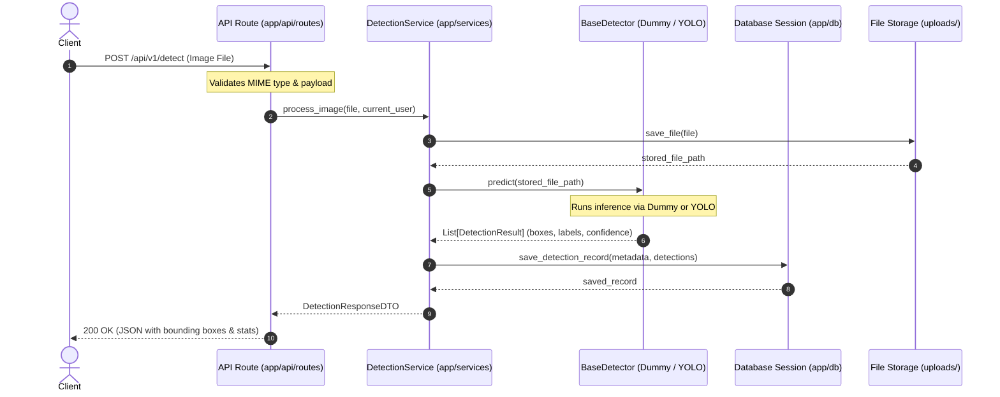

# Vision API Architecture

## 1. Overview & Design Goals

The **vision-api** backend template is structured for computer-vision hackathons and rapid prototyping. It decouples web routing, business orchestration, ML model inference, and data persistence into cleanly delineated layers.

### Key Objectives
- **Zero Heavy ML in Development**: The base environment runs without PyTorch, CUDA, or OpenCV. Developers can build frontend integrations, secure endpoints, and background jobs using a lightweight `DummyDetector`.
- **Plug-and-Play Detector Swapping**: The application adheres to the Dependency Inversion Principle. The ML engineer can drop in a `YoloDetector` implementing the `BaseDetector` contract without altering route controllers or business services.
- **Fail-Safe & Testable**: Each layer can be tested in isolation with mocked inputs or fast in-memory databases.

---

## 2. Layered Architecture

The system is organized into four primary architectural tiers:

```
+-----------------------------------------------------------+
|                      Client Layer                         |
|  (Web Browser / Mobile App / CLI / Frontend React-Vue)    |
+-----------------------------+-----------------------------+
                              | HTTP / Multipart Upload / WebSocket
                              v
+-----------------------------------------------------------+
|                   1. API Routes Layer                     |
|                 (app/api/routes/*.py)                     |
| - Request routing & HTTP status codes                     |
| - Parameter validation via Pydantic schemas               |
| - Authentication, CORS, and dependency injection          |
+-----------------------------+-----------------------------+
                              | Clean domain schemas / DTOs
                              v
+-----------------------------------------------------------+
|                   2. Services Layer                       |
|                 (app/services/*.py)                       |
| - Business logic & coordination                           |
| - Upload file lifecycle & storage validation              |
| - Orchestrating detector execution & post-processing      |
+---------------+-----------------------------+-------------+
                |                             |
                | Invokes predict()           | Persists detection records
                v                             v
+-----------------------------+  +--------------------------+
|    3. Detector Interface    |  |    4. Database Layer     |
|   (app/services/detector)   |  |   (app/db/, app/models/) |
| - Abstract BaseDetector ABC |  | - SQLAlchemy / SQLModel  |
| - DummyDetector (No ML)     |  | - Migrations (Alembic)   |
| - YoloDetector (Future ML)  |  | - SQLite / PostgreSQL    |
+-----------------------------+  +--------------------------+
```

### Detailed Layer Responsibilities

1. **API Routes (`app/api/routes/`)**
   - Exposes RESTful endpoints (e.g., `/health`, future `/api/v1/detect`).
   - Delegates validation to Pydantic schemas (`app/schemas/`).
   - Enforces authentication and authorization dependencies.
   - Converts service domain outputs to HTTP response formats.

2. **Services (`app/services/`)**
   - Contains core business logic (e.g., `DetectionService`, `StorageService`).
   - Handles file saving into `uploads/` and generates unique file identifiers.
   - Coordinates detector execution through the injected `BaseDetector`.

3. **Detector Abstraction (`app/services/`)**
   - Defines a standard interface for computer vision backends:
     ```python
     class BaseDetector(ABC):
         @abstractmethod
         def predict(self, file_path: str) -> list[DetectionResult]:
             pass
     ```
   - **`DummyDetector`**: Returns deterministic or mock bounding boxes with zero GPU/PyTorch requirements for immediate testing.
   - **`YoloDetector`**: Instantiated in later phases using Ultralytics YOLO weights from `models_store/`.

4. **Database & Storage Layer (`app/db/`, `app/models/`, `uploads/`)**
   - SQLAlchemy ORM models define schemas for detection history, images, and user accounts.
   - Raw binary uploads are stored on disk (`uploads/`), keeping database rows light with file paths and bounding box JSON.

---

## 3. End-to-End Request Flow

The following sequence diagram details how an image detection request traverses the system:



---

## 4. Plugging in a Future `YoloDetector`

One of the template's primary constraints is avoiding ML dependencies during early development. The detector interface ensures that switching to YOLO requires **zero modifications** to existing API routes or business services.

### Interface Definition
```python
from abc import ABC, abstractmethod
from typing import List
from pydantic import BaseModel

class BoundingBox(BaseModel):
    x_min: float
    y_min: float
    x_max: float
    y_max: float
    confidence: float
    label: str

class BaseDetector(ABC):
    @abstractmethod
    def load_model(self) -> None:
        """Load model weights into memory/GPU."""
        pass

    @abstractmethod
    def predict(self, image_path: str) -> List[BoundingBox]:
        """Perform object detection on an image path."""
        pass
```

### Swappable Implementations

1. **DummyDetector (Current Phase)**:
   - Does not import PyTorch, torchvision, or Ultralytics.
   - Generates mock bounding boxes (e.g., label `"person"` with 0.95 confidence) to verify data flow, WebSocket alerts, and UI rendering.

2. **YoloDetector (Future ML Phase)**:
   - Installs packages from `requirements-cv.txt`.
   - Loads weights from `models_store/yolov8n.pt`.
   - Implements the exact same `predict(image_path)` signature.

### Factory Pattern Resolution
A detector factory resolves the active implementation based on `.env`:

```python
def get_detector(settings: Settings = Depends(get_settings)) -> BaseDetector:
    if settings.DETECTOR_BACKEND == "dummy":
        return DummyDetector()
    elif settings.DETECTOR_BACKEND == "yolo":
        from app.services.yolo_detector import YoloDetector
        return YoloDetector(weights_path=settings.MODEL_PATH)
    raise ValueError(f"Unknown DETECTOR_BACKEND: {settings.DETECTOR_BACKEND}")
```

Because the router and service receive `BaseDetector` via FastAPI's dependency injection (`Depends(get_detector)`), updating `.env` to `DETECTOR_BACKEND=yolo` activates the real model without touching a single route or service line.
