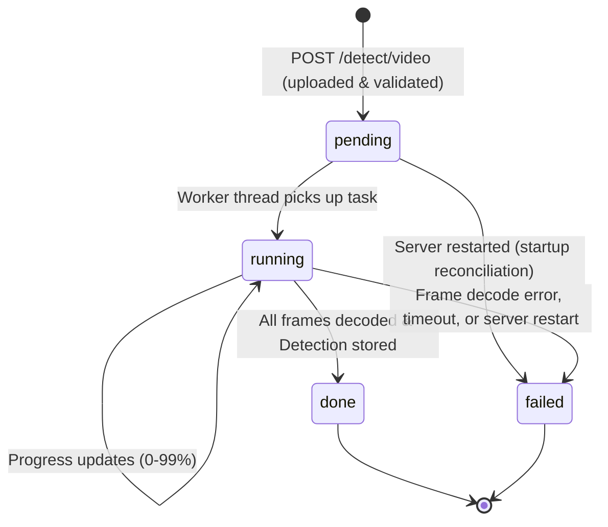
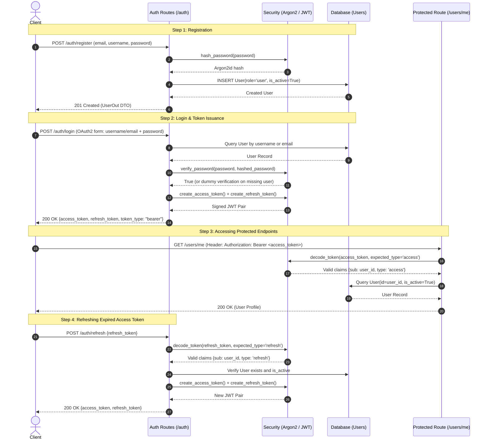
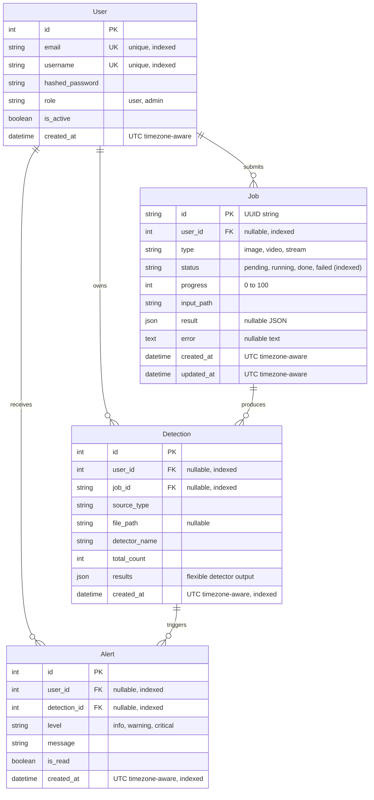
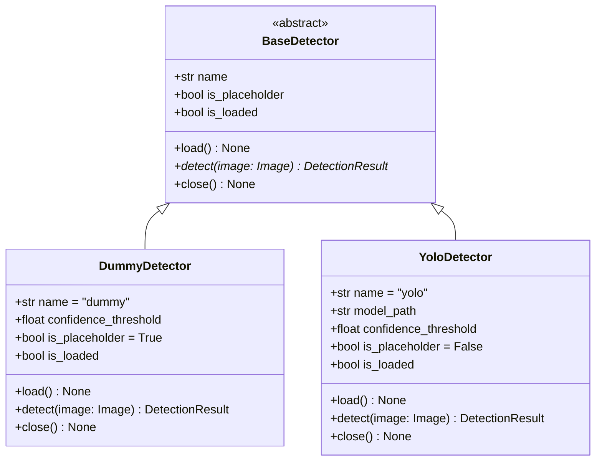
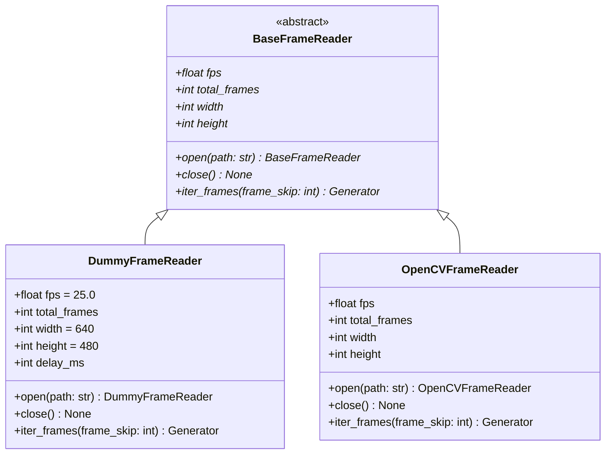
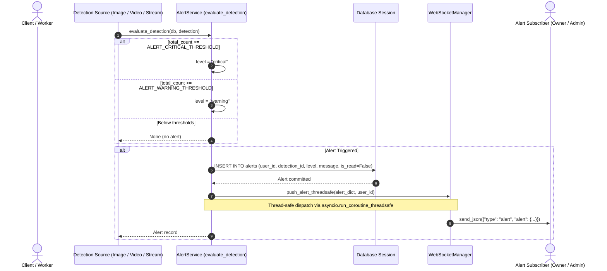
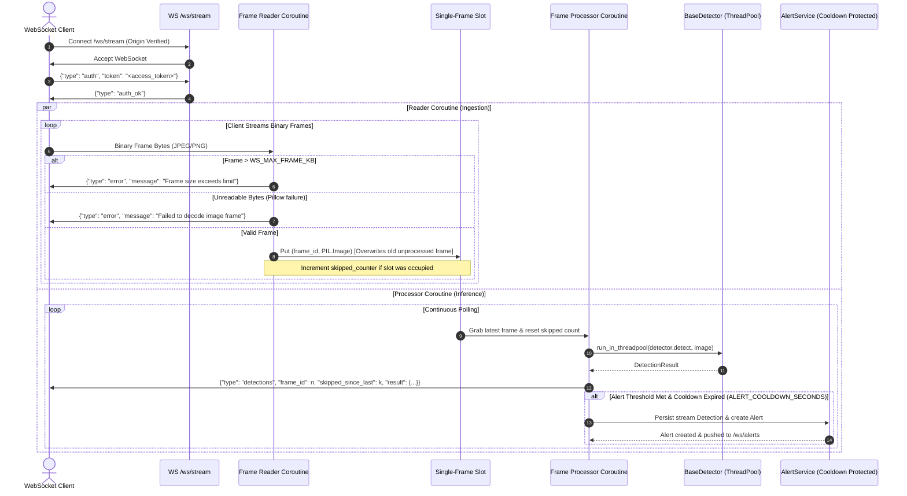

# Vision API Architecture

## 1. Overview & Design Goals

The **vision-api** backend template is structured for computer-vision hackathons and rapid prototyping. It decouples web routing, business orchestration, ML model inference, and data persistence into cleanly delineated layers.

### Key Objectives
- **Zero Heavy ML in Development**: The base environment runs without PyTorch, CUDA, or OpenCV. Developers can build frontend integrations, secure endpoints, and background jobs using a lightweight `DummyDetector`.
- **Plug-and-Play Detector Swapping**: The application adheres to the Dependency Inversion Principle. The ML engineer can drop in a `YoloDetector` implementing the `BaseDetector` contract without altering route controllers or business services.
- **Fail-Safe & Testable**: Each layer can be tested in isolation with mocked inputs or fast in-memory databases.

---

## 2. Layered Architecture

The system is organized into four primary architectural tiers:

```
+-----------------------------------------------------------+
|                      Client Layer                         |
|  (Web Browser / Mobile App / CLI / Frontend React-Vue)    |
+-----------------------------+-----------------------------+
                              | HTTP / Multipart Upload / WebSocket
                              v
+-----------------------------------------------------------+
|                   1. API Routes Layer                     |
|                 (app/api/routes/*.py)                     |
| - Request routing & HTTP status codes                     |
| - Parameter validation via Pydantic schemas               |
| - Authentication, CORS, and dependency injection          |
+-----------------------------+-----------------------------+
                              | Clean domain schemas / DTOs
                              v
+-----------------------------------------------------------+
|                   2. Services Layer                       |
|                 (app/services/*.py)                       |
| - Business logic & coordination                           |
| - Upload file lifecycle & storage validation              |
| - Orchestrating detector execution & post-processing      |
+---------------+-----------------------------+-------------+
                |                             |
                | Invokes predict()           | Persists detection records
                v                             v
+-----------------------------+  +--------------------------+
|    3. Detector Interface    |  |    4. Database Layer     |
|   (app/services/detector)   |  |   (app/db/, app/models/) |
| - Abstract BaseDetector ABC |  | - SQLAlchemy / SQLModel  |
| - DummyDetector (No ML)     |  | - Migrations (Alembic)   |
| - YoloDetector (Future ML)  |  | - SQLite / PostgreSQL    |
+-----------------------------+  +--------------------------+
```

### Detailed Layer Responsibilities

1. **API Routes (`app/api/routes/`)**
   - Exposes RESTful endpoints (e.g., `/health`, `/auth/*`, `/users/*`, future `/api/v1/detect`).
   - Delegates validation to Pydantic schemas (`app/schemas/`).
   - Enforces authentication and authorization dependencies (`app/api/deps.py`).
   - Converts service domain outputs to HTTP response formats.

2. **Services (`app/services/`)**
   - Contains core business logic (e.g., `DetectionService`, `StorageService`).
   - Handles file saving into `uploads/` and generates unique file identifiers.
   - Coordinates detector execution through the injected `BaseDetector`.

3. **Detector Abstraction (`app/services/`)**
   - Defines a standard interface for computer vision backends:
     ```python
     class BaseDetector(ABC):
         @abstractmethod
         def predict(self, file_path: str) -> list[DetectionResult]:
             pass
     ```
   - **`DummyDetector`**: Returns deterministic or mock bounding boxes with zero GPU/PyTorch requirements for immediate testing.
   - **`YoloDetector`**: Instantiated in later phases using Ultralytics YOLO weights from `models_store/`.

4. **Database & Storage Layer (`app/db/`, `app/models/`, `uploads/`)**
   - SQLAlchemy ORM models define schemas for users, jobs, detection history, and alerts.
   - Raw binary uploads are stored on disk (`uploads/`), keeping database rows light with file paths and bounding box JSON.

---

## 3. End-to-End Request Flow (POST /detect/image)

The following sequence diagram details how an image detection request traverses the system (validate, save, detect, store, respond):

```mermaid
sequenceDiagram
    autonumber
    actor Client
    participant Router as API Route (POST /detect/image)
    participant Dep as Dependencies (Auth, DB, Settings)
    participant Svc as Image Service (validate_and_save_image)
    participant Disk as File Storage (uploads/images/)
    participant Detector as BaseDetector (Dummy / YOLO)
    participant DB as Database Session (app/db)

    Client->>Router: POST /detect/image (Multipart Form, Bearer Token)
    Router->>Dep: get_current_user(token) & get_db()
    Dep-->>Router: Authenticated User & DB Session

    Note over Router: Verify app.state.detector is ready (HTTP 503 if None)

    Router->>Svc: validate_and_save_image(file, settings)
    Note over Svc: 1. Validate MIME type in ALLOWED_IMAGE_TYPES (HTTP 415)
    Note over Svc: 2. Stream read in chunks; abort on MAX_UPLOAD_MB (HTTP 413)
    Note over Svc: 3. Reject empty files (HTTP 400)
    Note over Svc: 4. Verify bytes with Pillow img.verify() (HTTP 400 if bad)
    Note over Svc: 5. Reopen, check MAX_IMAGE_DIMENSION, convert to RGB
    Note over Svc: 6. Resolve extension from Pillow format, generate UUID

    Svc->>Disk: Write original bytes to uploads/images/<uuid4>.<ext>
    Disk-->>Svc: Persisted relative file path
    Svc-->>Router: (rgb_image, file_path)

    Router->>Detector: detect(rgb_image)
    Note over Detector: Execute inference in threadpool<br/>(measure inference_ms, filter by CONFIDENCE_THRESHOLD)
    Detector-->>Router: DetectionResult (objects, total_count, inference_ms)

    Router->>DB: INSERT Detection(user_id, source_type="image", file_path, results)
    DB-->>Router: Persisted Detection record

    Router-->>Client: HTTP 201 Created (DetectionOut JSON)
```

### 3.2 Asynchronous Video Processing Flow (POST /detect/video & Polling GET /jobs/{job_id})

The following sequence diagram details asynchronous video submission, thread pool execution, and status polling:

```mermaid
sequenceDiagram
    autonumber
    actor Client
    participant Router as API Route (POST /detect/video)
    participant Dep as Dependencies (Auth, DB, Settings)
    participant Svc as Video Service (validate_and_save_video)
    participant Disk as File Storage (uploads/videos/)
    participant DB as Database Session (app/db)
    participant Runner as Job Runner (ThreadPoolExecutor)
    participant Worker as Background Worker (process_video_job)
    participant Reader as Frame Reader (Dummy / OpenCV)
    participant Detector as BaseDetector (Dummy / YOLO)

    %% 1. Submission
    Client->>Router: POST /detect/video (Multipart Form, Bearer Token)
    Router->>Dep: get_current_user(token) & get_db()
    Dep-->>Router: Authenticated User & DB Session
    Note over Router: Verify detector ready (503 if None)<br/>Verify active jobs limit (429 if >= MAX_ACTIVE_JOBS)

    Router->>Svc: validate_and_save_video(file, settings)
    Note over Svc: 1. Validate MIME in ALLOWED_VIDEO_TYPES (415)<br/>2. Inspect container signature (ftyp, webm, avi) (400)<br/>3. Stream chunks; enforce MAX_VIDEO_UPLOAD_MB (413)
    Svc->>Disk: Stream bytes to uploads/videos/<uuid4>.<ext>
    Disk-->>Svc: Persisted relative video path
    Svc-->>Router: video_path

    Router->>DB: INSERT Job(type="video", status="pending", progress=0, input_path)
    DB-->>Router: Persisted Job record (job_id)

    Router->>Runner: submit(job_id, frame_skip)
    Runner-->>Router: Queued in ThreadPoolExecutor
    Router-->>Client: HTTP 202 Accepted {job_id, status: "pending", progress: 0}

    %% 2. Background Execution
    Runner->>Worker: Execute in worker thread (process_video_job)
    Note over Worker: Worker creates dedicated SessionLocal()
    Worker->>DB: UPDATE Job SET status="running", progress=0
    Worker->>Reader: open(video_path)
    Reader-->>Worker: Video stream metadata (total_frames, fps, width, height)

    loop Every sampled frame (iter_frames)
        Reader-->>Worker: (frame_idx, timestamp_s, pil_rgb_image)
        Worker->>Detector: detect(pil_rgb_image)
        Detector-->>Worker: DetectionResult
        Note over Worker: Track peak frame & downsampled timeline
        opt Periodic progress update (every 5% or 1 sec)
            Worker->>DB: UPDATE Job SET progress=X, updated_at=NOW()
        end
    end

    Worker->>DB: UPDATE Job SET status="done", progress=100, result=JSON
    Worker->>DB: INSERT Detection(source_type="video", job_id, peak_count, results)
    Note over Worker: Close reader & close worker DB session

    %% 3. Polling
    loop Polling until completed
        Client->>Router: GET /jobs/{job_id} (Bearer Token)
        Router->>DB: SELECT Job WHERE id=job_id
        DB-->>Router: Job record
        Router-->>Client: HTTP 200 OK {status: "running" | "done", progress, result: null | JSON}
    end
```

### 3.3 Job Lifecycle State Machine



---

## 4. Authentication & Authorization Flow

The platform uses JWT-based stateless authentication with dual access/refresh tokens and Argon2id password hashing:



---

## 5. Database Schema & Entity-Relationship (ER) Diagram

The persistence layer models core domain concepts: user identities, background jobs, detection outputs, and notification alerts.



---

## 6. Detector Architecture & Class Hierarchy

The detector package in `app/services/detector/` adheres strictly to the Dependency Inversion Principle. The web application, routes, and services depend exclusively on the abstract `BaseDetector` contract.

### Class Diagram



### Interface Definition (`app/services/detector/base.py`)
```python
from abc import ABC, abstractmethod
from PIL import Image
from app.schemas.detection import DetectionResult

class BaseDetector(ABC):
    name: str = "base"
    _is_loaded: bool = False

    @property
    def is_placeholder(self) -> bool:
        return False

    @property
    def is_loaded(self) -> bool:
        return self._is_loaded

    def load(self) -> None:
        """Load model weights into memory. Executed once during startup lifespan."""
        self._is_loaded = True

    @abstractmethod
    def detect(self, image: Image.Image) -> DetectionResult:
        """Perform object detection on a decoded RGB PIL Image."""
        pass

    def close(self) -> None:
        """Clean up handles or GPU memory on application shutdown."""
        pass
```

### Swappable Implementations

1. **DummyDetector (`app/services/detector/dummy.py`)**:
   - Zero ML/GPU/NumPy dependencies.
   - Generates deterministic simulated detections (seeded via SHA-256 hash of image dimensions and raw pixel bytes).
   - Bounds every box inside image coordinates (`0 <= x1 < x2 <= width`, `0 <= y1 < y2 <= height`).
   - Filters candidate detections by `CONFIDENCE_THRESHOLD` and measures `inference_ms` with `time.perf_counter`.

2. **YoloDetector (`app/services/detector/yolo_detector.py`)**:
   - Clean stub raising `NotImplementedError` until the ML partner implements it.
   - Module top-level is completely free of ML imports (lazy import inside `load()`).
   - Ready for drop-in activation with `requirements-cv.txt` and model weights in `models_store/`.

### Factory Pattern Resolution (`app/services/detector/factory.py`)
A detector factory resolves the active implementation based on `Settings`:

```python
def get_detector(settings: Optional[Settings] = None) -> BaseDetector:
    if settings is None:
        settings = get_settings()
    backend = (settings.DETECTOR_BACKEND or "").strip().lower()
    if backend == "dummy":
        return DummyDetector(confidence_threshold=settings.CONFIDENCE_THRESHOLD)
    elif backend == "yolo":
        return YoloDetector(
            model_path=settings.MODEL_PATH,
            confidence_threshold=settings.CONFIDENCE_THRESHOLD,
        )
    raise ValueError(f"Invalid DETECTOR_BACKEND '{settings.DETECTOR_BACKEND}'. Supported options: dummy, yolo.")
```

During application lifespan startup in `app/main.py`, the detector is initialized and loaded once, stored on `app.state.detector`, and gracefully closed during shutdown.

---

## 7. Video Frame Reader Architecture & Class Hierarchy

The frame reader package in `app/services/video/` abstracts video decoding behind the `BaseFrameReader` interface, mirroring the detector design. The application core remains 100% free of heavy native OpenCV or FFmpeg dependencies.

### Class Diagram



### Interface Contract (`app/services/video/base.py`)
```python
class BaseFrameReader(ABC):
    @abstractmethod
    def open(self, path: str) -> "BaseFrameReader":
        pass

    @abstractmethod
    def close(self) -> None:
        pass

    @property
    @abstractmethod
    def fps(self) -> float:
        pass

    @property
    @abstractmethod
    def total_frames(self) -> int:
        pass

    @abstractmethod
    def iter_frames(
        self, frame_skip: int = 1
    ) -> Generator[Tuple[int, float, Image.Image], None, None]:
        pass
```

### Swappable Implementations
1. **DummyFrameReader (`app/services/video/dummy.py`)**:
   - Zero OpenCV/FFmpeg dependencies.
   - Derives frame counts (between 60 and 300) from file size.
   - Generates synthetic solid-color PIL Images whose RGB values vary by frame index.
   - Sleeps for `DUMMY_FRAME_DELAY_MS` between frames so progress is visible in UI/polling.
2. **OpenCVFrameReader (`app/services/video/opencv_reader.py`)**:
   - Clean stub raising `NotImplementedError` until the partner implements it.
   - Lazily imports `cv2` inside `open()`, keeping module top-level clean.

---

## 9. Real-Time Alerts, WebSockets & Analytics Architecture (Step 6)

### 9.1 Alert Flow Sequence Diagram

When detections occur via image upload (`POST /detect/image`), asynchronous video processing (`JobRunner`), or live stream frames (`WS /ws/stream`), the `evaluate_detection()` service inspects `total_count` against `ALERT_WARNING_THRESHOLD` and `ALERT_CRITICAL_THRESHOLD`. If triggered, an `Alert` record is persisted in the database, and the event is broadcast thread-safely to active WebSocket alert clients.



### 9.2 Real-Time Stream Flow Sequence Diagram (WS /ws/stream)

The live frame ingestion endpoint (`/ws/stream`) uses a producer-consumer "latest frame wins" design with two concurrent coroutines. This prevents backpressure and frame queues from lagging when inference takes longer than frame delivery.



### 9.3 Analytics Architecture

The analytics module (`/analytics/summary` and `/analytics/timeseries`) provides high-performance metrics aggregation across detection history:
- **Zero-Engine Overhead**: Detections within the requested time range (validated up to `ANALYTICS_MAX_RANGE_DAYS`, defaulting to 7 days) are fetched up to `ANALYTICS_MAX_ROWS` and aggregated in memory in Python. This ensures portability between SQLite and PostgreSQL without database-specific date functions.
- **Truncation Protection**: If historical records reach `ANALYTICS_MAX_ROWS`, the summary response includes `"truncated": true`.
- **Zero-Gap Continuous Timeseries**: `/analytics/timeseries` partitions data into hourly (`interval=hour`) or daily (`interval=day`) buckets, pre-filling all intervals across the date range with zeroes so frontend graphing libraries receive continuous data without interpolation gaps.
- **Role-Based Scoping**: Standard users receive analytics for their own detections; administrators view platform-wide aggregated metrics.
